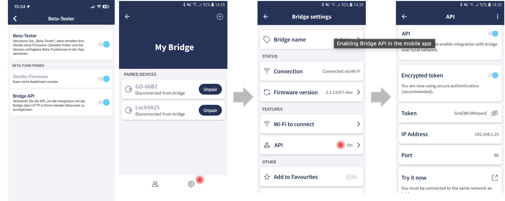

# ioBroker.tedee

[](https://www.npmjs.com/package/iobroker.tedee)
[](https://www.npmjs.com/package/iobroker.tedee)


[](https://nodei.co/npm/iobroker.tedee/)

**Tests:** 

**This adapter uses Sentry libraries to automatically report exceptions and code errors to the developers.** For more details and for information how to disable the error reporting see [Sentry-Plugin Documentation](https://github.com/ioBroker/plugin-sentry#plugin-sentry)! Sentry reporting is used starting with js-controller 3.0.

## tedee adapter for ioBroker

Adapter for Tedee Locks

This Adapter uses the local bridge API to control a tedee lock

All Lock devices by Tedee are supported.

1. Activate Beta Testing in your user profile
2. Enable API in the bridge settings
3. Copy the IP and the token in the instance settings



The Adapter receives all status update immediatly via webhooks. The interval in the settings is only a backup for continuously refreshs.

### Webhooks / Callback host

The adapter starts a small web server (port 29170 or the next free port) and registers it at the bridge. The bridge must be able to reach this port, e.g. allow it in the firewall if the bridge is in a separate (IoT) network.

By default the first IPv4 address of the ioBroker system is used. Set **Callback host** in the instance settings if this is not the right one, e.g. with Docker, several network interfaces or to use IPv6.

Only webhooks pointing to this ioBroker system are removed on start/stop, webhooks of other systems (e.g. Home Assistant) are kept.

Current State of a lock:
tedee.0.id.state

- 0 Uncalibrated
- 1 Calibrating
- 2 Unlocked
- 3 SemiLocked
- 4 Unlocking
- 5 Locking
- 6 Locked
- 7 Pulled
- 8 Pulling
- 9 Unknown
- 18 Updating
- 255 Unpulling

## Usage

You can control the tedee lock via tedee.0.id.remote

- lock to Lock/Unlock
- pull to Pull
- unlock unlock

Unlock modes:

- 0 - (or no parameter set) - Normal. From close position: unlock only or unlock with auto pull if enabled. From open position: nothing.
- 2 - Force. Force movement until lock hits resistance.
- 3 - Without Pull. From close position: unlock only without auto pull. From open position: nothing.
- 4 - Unlock or Pull. From close position: unlock only or unlock with auto pull if enabled. From open position: pull.

## Last action (who opened the door)

Each lock gets a channel `tedee.0.<lockId>.lastAction`, filled by the webhooks:

| State        | Content                                                                     |
| ------------ | --------------------------------------------------------------------------- |
| `action`     | `unlock`, `lock` or `pull`. Written last, use it as trigger in scripts      |
| `source`     | how: 1 = Button / manual, 2 = App / API, 10 = Keypad, 23 = Fingerprint      |
| `sourceName` | text of `source`                                                            |
| `userId`     | Tedee user id (app), PIN id (keypad) or fingerprint id; empty if unknown    |
| `pinAlias`   | name of the PIN for keypad actions (Bridge API 1.19+, loaded from the lock) |

The `source` values are not documented by Tedee and were determined with a Lock PRO and Keypad PRO. Unknown values are shown as `Unknown (n)`, please report them.

The PIN names are read from the lock once at start and again when an unknown PIN id is used. While reading, the bridge is blocked (about 1 second per 5 PINs). Disable **Load PIN names for lastAction** in the instance settings (tab _PINs_) if you do not need `pinAlias`.

## PIN management

Shows all keypad PINs of a lock in ioBroker and lets you create, change and delete PINs, e.g. a guest PIN that only works on weekends. Requires a Tedee Keypad and Bridge API 1.19 or newer.

### Enable

Instance settings → tab **PINs** → **Enable PIN management**. The feature is off by default because it changes access codes of your door.

**Security:** the PIN codes themselves are never written to states or to the log. Anybody who can write to the `delete` buttons or send `sendTo` commands to the adapter (scripts, VIS, cloud/IoT adapters) can change the PINs of your door, so restrict access accordingly.

### States

| State                       | Content                                                               |
| --------------------------- | --------------------------------------------------------------------- |
| `pins.count`                | number of PINs                                                        |
| `pins.list`                 | all PINs as JSON array (same fields as below), e.g. for VIS tables    |
| `pins.listVersion`          | version of the PIN list on the lock, increases with every change      |
| `pins.refresh`              | button: reload the PINs from the lock                                 |
| `pins.<pinId>.alias`        | name of the PIN                                                       |
| `pins.<pinId>.active`       | `true` if the PIN can be used right now (date, weekday, daily window) |
| `pins.<pinId>.validFrom`    | start of validity (timestamp, `null` = unbounded)                     |
| `pins.<pinId>.validTo`      | end of validity (timestamp, `null` = unbounded)                       |
| `pins.<pinId>.dayStart`     | daily window start `HH:MM` (empty = whole day)                        |
| `pins.<pinId>.dayEnd`       | daily window end `HH:MM` (empty = whole day)                          |
| `pins.<pinId>.weekdays`     | weekdays as bitmask: 1 = Mon, 2 = Tue, 4 = Wed … 64 = Sun, 127 = all  |
| `pins.<pinId>.weekdaysText` | weekdays as text, e.g. `Sat,Sun` or `every day`                       |
| `pins.<pinId>.delete`       | button: delete this PIN from the lock                                 |

The list is loaded at adapter start, after every change made by the adapter and every 15 minutes (changes made in the Tedee app). Use `pins.refresh` to load it immediately. `active` is calculated with the time zone of the ioBroker host.

### Commands (sendTo)

All commands return `{ error: '...' }` if something went wrong. `lockId` can be omitted if only one lock is connected.

| Command       | Parameters                                                             | Result                    |
| ------------- | ---------------------------------------------------------------------- | ------------------------- |
| `getPins`     | `lockId`                                                               | `{ lockId, pins: [...] }` |
| `getPin`      | `lockId`, `pinId`, `includeCode` (optional, `true` = also return code) | `{ lockId, pin: {...} }`  |
| `createPin`   | `lockId`, `pin`, `alias`, optional: validity fields (see below)        | `{ lockId, pinId }`       |
| `updatePin`   | `lockId`, `pinId`, only the fields to change                           | `{ lockId, pinId }`       |
| `deletePin`   | `lockId`, `pinId`                                                      | `{ lockId, pinId }`       |
| `refreshPins` | `lockId`                                                               | `{ lockId, pins: [...] }` |

Fields for `createPin` / `updatePin`:

| Field          | Format                                                                                         |
| -------------- | ---------------------------------------------------------------------------------------------- |
| `pin`          | string with 5 – 8 digits, e.g. `'048213'` (use a string, otherwise leading zeros are lost)     |
| `alias`        | name, max. 32 bytes                                                                            |
| `startDate`    | `'2026-11-01'`, `'2026-11-01T08:00'`, timestamp in ms or s; `null` = unbounded                 |
| `endDate`      | as `startDate`; a plain date means the end of that day (23:59:59)                              |
| `dayStartTime` | `'08:00'` or seconds from midnight; `null` = whole day                                         |
| `dayEndTime`   | `'16:30'` or seconds from midnight; `null` = whole day                                         |
| `weekdays`     | `['Sat', 'Sun']` (also German `['Sa', 'So']`), day numbers `[6, 7]` (1 = Mon) or bitmask `96` |

`updatePin` keeps all fields that are not given, including the PIN code.

### Examples (JavaScript adapter)

```js
// list all PINs
sendTo('tedee.0', 'getPins', {}, (res) => log(JSON.stringify(res)));

// guest PIN: November, weekends, 10:00 - 18:00
sendTo(
  'tedee.0',
  'createPin',
  {
    pin: '482913',
    alias: 'Guest',
    startDate: '2026-11-01',
    endDate: '2026-11-30',
    weekdays: ['Sat', 'Sun'],
    dayStartTime: '10:00',
    dayEndTime: '18:00',
  },
  (res) => (res.error ? log(res.error, 'warn') : log(`created PIN ${res.pinId}`)),
);

// extend the guest PIN until end of December, everything else stays
sendTo('tedee.0', 'updatePin', { pinId: 5, endDate: '2026-12-31' }, (res) => log(JSON.stringify(res)));

// delete a PIN
sendTo('tedee.0', 'deletePin', { pinId: 5 }, (res) => log(JSON.stringify(res)));
```

In Blockly use the block **sendTo** (category _Actions_) with instance `tedee.0`, the command and the parameters as JSON.

### Notes

- While the bridge reads the PIN list, it cannot handle other requests (about 1 second per 5 PINs, plus one request per PIN for the details).
- If the Tedee app changes PINs at the same moment, the bridge answers "another PIN operation is in progress" — just try again.
- With PIN management enabled, **Load PIN names for lastAction** is not needed, `lastAction.pinAlias` uses the same list.
- When PIN management is switched off, the `pins` channels are removed at the next start.

## Changelog

<!--
    Placeholder for the next version (at the beginning of the line):
    ### **WORK IN PROGRESS**
-->
### **WORK IN PROGRESS**

- (Schimi1983) PIN management: show, create, change and delete keypad PINs (states `pins.*`, sendTo commands)
- (Schimi1983) Instance settings with tabs, translations moved to `admin/i18n`
- (ioBroker-Bot) Adapter requires admin >= 7.8.23 now.
- (Schimi1983) Migrated to ESLint 9 with `@iobroker/eslint-config`
- (Schimi1983) Adapter timers (`this.setTimeout`) and `node:` prefix for built-in modules
- (Schimi1983) Fix: webhook URL now uses an IP address instead of the ioBroker host name (new optional setting "Callback host")
- (Schimi1983) Fix: only own webhooks are removed from the bridge, webhooks of other integrations (e.g. Home Assistant) are kept
- (Schimi1983) Fix: lock/unlock/pull commands are no longer repeated automatically on 405/406 or connection errors
- (Schimi1983) Fix: "mode" header is only sent for unlock and validated (0, 2, 3, 4)
- (Schimi1983) Fix: polling waits for the previous request (bridge handles one request at a time)
- (Schimi1983) Fix: added lock state 255 (Unpulling), state 3 (partially open) sets remote.lock to false
- (Schimi1983) Webhook server listens on IPv4 and IPv6
- (Schimi1983) New channel `lastAction` per lock: who/how the lock was operated (app, keypad PIN incl. PIN alias, fingerprint) [#13]
- (Schimi1983) Node.js >= 22, js-controller >= 6.0.11 and admin >= 7.6.17 required
- (Schimi1983) Dependencies updated, tests for Node.js 22, 24 and 26
- (Schimi1983) Admin UI: responsive layout

### 0.3.2 (2024-04-10)

- add retry when request fails

### 0.3.1 (2023-12-16)

- (TA2k) initial release

## Disclaimer

Tedee is a trademark of tedee. I am in no way endorsed by or affiliated with tedee, or any associated subsidiaries, logos or trademarks

## License

MIT License

Copyright (c) 2024-2025 TA2k <tombox2020@gmail.com>

Permission is hereby granted, free of charge, to any person obtaining a copy
of this software and associated documentation files (the "Software"), to deal
in the Software without restriction, including without limitation the rights
to use, copy, modify, merge, publish, distribute, sublicense, and/or sell
copies of the Software, and to permit persons to whom the Software is
furnished to do so, subject to the following conditions:

The above copyright notice and this permission notice shall be included in all
copies or substantial portions of the Software.

THE SOFTWARE IS PROVIDED "AS IS", WITHOUT WARRANTY OF ANY KIND, EXPRESS OR
IMPLIED, INCLUDING BUT NOT LIMITED TO THE WARRANTIES OF MERCHANTABILITY,
FITNESS FOR A PARTICULAR PURPOSE AND NONINFRINGEMENT. IN NO EVENT SHALL THE
AUTHORS OR COPYRIGHT HOLDERS BE LIABLE FOR ANY CLAIM, DAMAGES OR OTHER
LIABILITY, WHETHER IN AN ACTION OF CONTRACT, TORT OR OTHERWISE, ARISING FROM,
OUT OF OR IN CONNECTION WITH THE SOFTWARE OR THE USE OR OTHER DEALINGS IN THE
SOFTWARE.
